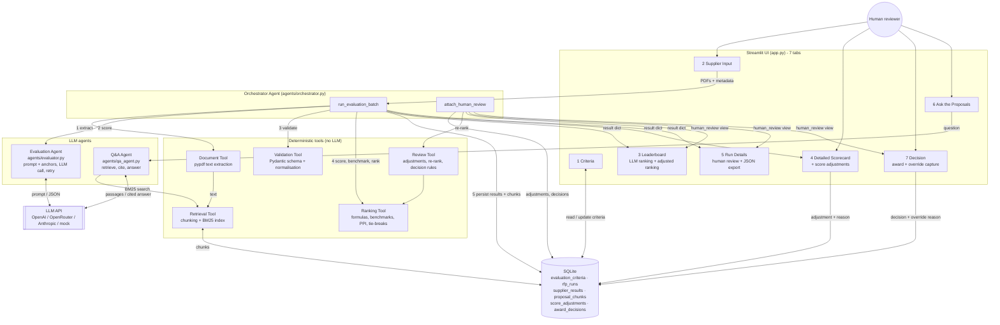
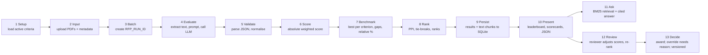

# Agentic RFP Evaluation and Supplier Ranking — Build Plan

**Scenario:** CTMS (Clinical Trial Management System) implementation for a pharma sponsor
**Stack:** Streamlit · SQLite · Python 3.10 · any JSON-capable LLM
**Format:** Individual project · 1-day submission · deployed on Streamlit Community Cloud

This document is the single reference for building the project. Follow the phases in order. Every phase ends with a checkpoint you can verify before moving on.

---

## Table of Contents

1. [Project Overview](#1-project-overview)
2. [Business Scenario (CTMS)](#2-business-scenario-ctms)
3. [Architecture](#3-architecture)
4. [Folder Structure](#4-folder-structure)
5. [Database Design](#5-database-design)
6. [Evaluation Criteria](#6-evaluation-criteria)
7. [Scoring Formulas and Worked Example](#7-scoring-formulas-and-worked-example)
8. [LLM Contract](#8-llm-contract)
9. [Validation Rules](#9-validation-rules)
10. [Module Specifications](#10-module-specifications)
11. [Streamlit Screens](#11-streamlit-screens)
12. [Synthetic Supplier Proposals](#12-synthetic-supplier-proposals)
13. [Step-by-Step Build Process](#13-step-by-step-build-process)
14. [Testing Plan](#14-testing-plan)
15. [Deployment](#15-deployment)
16. [Submission Checklist](#16-submission-checklist)
17. [Rubric Mapping](#17-rubric-mapping)
18. [Assumptions and Design Decisions](#18-assumptions-and-design-decisions)

---

## 1. Project Overview

A procurement team receives several supplier proposals (RFP responses) as PDFs. Reading and comparing them by hand is slow and inconsistent. This application:

1. Reads each proposal PDF.
2. Asks an LLM to score the proposal against configurable, weighted criteria and cite evidence.
3. Validates and normalises the LLM output.
4. Applies deterministic Python formulas for weighted scores, peer benchmarks, gaps, relative performance and a Peer Performance Index (PPI).
5. Ranks suppliers with a mandatory tie-break order.
6. Persists the complete run to SQLite and presents a leaderboard, scorecards and a JSON download.

**Golden rule:** the LLM judges proposal content only. All arithmetic, benchmarks, tie-breaks and ranks are computed by Python. The same validated scorecards must always produce the same ordering.

---

## 2. Business Scenario (CTMS)

**The buyer:** a mid-size pharma sponsor running about 40 active clinical studies across 12 countries. It uses a legacy on-premise CTMS plus spreadsheets.

**The RFP:** replace the legacy CTMS with a validated, cloud-based CTMS that:

- integrates with the electronic Trial Master File (eTMF), Electronic Data Capture (EDC) and SAP finance,
- automates investigator site payments,
- is fully migrated within 12 months,
- meets 21 CFR Part 11, GxP validation, GDPR and ISO 27001 requirements.

**The bidders (all fictional):**

| Supplier | Profile |
|---|---|
| Apex Systems | Strongest integration architecture (named APIs for eTMF/EDC/SAP), full Part 11 validation pack, highest price, 14-month timeline |
| BrightPath Tech | Lowest price, 7-month timeline, validation "handled by the client", no GDPR data-residency detail, two small biotech references |
| NexaWorks | Mid price, best wave-based migration plan with milestones, dedicated validation lead, clear SLA tiers and hypercare |
| Orbit Digital | 15 pharma references and 10 years in market, medium price, integration described only as "standard connectors" |

---

## 3. Architecture

### 3.1 Component Diagram



### 3.2 Ten-Step Data Flow



Steps 1-10 are the brief's required pipeline. Steps 11-13 are the additions: retrieval-augmented Q&A and the human-in-the-loop review, both recorded beside the LLM results without changing them.

### 3.3 ASCII Fallback (for viewers without Mermaid)

```
                              (Human reviewer)
                                      |
+-----------------------------------------------------------------------------------+
|                           STREAMLIT UI  (app.py) - 7 tabs                         |
| 1 Criteria | 2 Supplier Input | 3 Leaderboard | 4 Scorecard | 5 Run Details       |
|            |                  |  LLM + adjusted |  + adjust  |  review + export    |
| 6 Ask the Proposals (RAG)     | 7 Decision (award, override reason, versions)     |
+--------------------+-----------------------------+------------------+-------------+
                     | PDFs + metadata             | question         | adjustments /
                     v                             v                  | decisions
+----------------------------------------+   +-----------------+      v
| ORCHESTRATOR AGENT (agents/orchestrator)|   | Q&A AGENT       |  +-----------------+
| run_evaluation_batch:                   |   | agents/qa_agent |  | REVIEW TOOL     |
|  run id -> per supplier: extract ->     |   | retrieve ->     |  | tools/review    |
|  chunk -> evaluate -> validate ->       |   | prompt -> cite  |  | validate adjust |
|  score -> benchmark -> rank -> persist  |   +--------+--------+  | / decision,     |
| attach_human_review: adjustments +      |            |           | re-rank via     |
|  decisions -> adjusted view for UI/JSON |            |           | Ranking Tool    |
+----+-----------+-----------+------------+            |           +--------+--------+
     |           |           |          |              |                    |
     v           v           v          v              v                    v
+----------+ +----------+ +----------+ +----------+ +------------+   +----------+
| Document | | Evaluat. | | Validat. | | Ranking  | | Retrieval  |   | Ranking  |
| Tool     | | Agent    | | Tool     | | Tool     | | Tool       |   | Tool     |
| pypdf    | | prompt + | | Pydantic | | formulas | | chunk +    |   | (reused) |
|          | | anchors, | | normalise| | PPI, tie | | BM25       |   +----------+
|          | | LLM call | |          | | -breaks  | +------------+
+----------+ +----+-----+ +----------+ +----------+
                  |
                  v
          +---------------+        +------------------------------------------+
          | LLM API       |        | SQLite                                   |
          | OpenAI /      |        | evaluation_criteria  rfp_runs            |
          | OpenRouter /  |        | supplier_results     proposal_chunks     |
          | Anthropic /   |        | score_adjustments    award_decisions     |
          | mock          |        +------------------------------------------+
          +---------------+
```

### 3.4 Separation of Responsibilities

| Layer | May do | Must never do |
|---|---|---|
| LLM (Evaluation Agent) | Read proposal text, assign a 0–10 score per criterion, write justification, quote evidence, list risks | Compute weighted totals, compare suppliers, break ties, assign ranks |
| Validation Tool | Enforce schema, fill missing criteria, clip ranges, record warnings | Change a valid score |
| Ranking Tool | All arithmetic, benchmarks, PPI, sorting, rank assignment | Call the LLM |
| Orchestrator | Sequence tools, handle per-supplier failures, log steps; compose the human-review view | Contain formula logic |
| Retrieval Tool | Chunk proposal text; BM25 search for Q&A | Influence scores or ranks |
| Q&A Agent (LLM) | Answer a question from retrieved passages, citing suppliers | Use outside knowledge; change any score |
| Review Tool | Validate reviewer adjustments and decisions; re-rank via the Ranking Tool | Overwrite an LLM score; accept an override without a reason |
| Human reviewer | Adjust scores with reasons; record the award decision | Act anonymously; override without category and justification |

---

## 4. Folder Structure

```
rfp-evaluator/
├── app.py                        # Streamlit entry point (all screens)
├── requirements.txt
├── README.md
├── BUILD_PLAN.md                 # this file
├── .gitignore
├── .streamlit/
│   ├── config.toml               # theme, server settings
│   └── secrets.toml.example      # LLM_API_KEY placeholder (never commit real key)
├── agents/
│   ├── __init__.py
│   ├── orchestrator.py           # run_evaluation_batch(), load_run_result(), attach_human_review()
│   ├── evaluator.py              # build_prompt(), evaluate_supplier(), provider clients
│   └── qa_agent.py               # answer_question() - retrieval-augmented Q&A
├── tools/
│   ├── __init__.py
│   ├── document_tool.py          # extract_text()
│   ├── validation_tool.py        # Pydantic models, validate_and_normalise()
│   ├── ranking_tool.py           # score_and_rank(), rank_suppliers(), explain_tie_breaks()
│   ├── retrieval_tool.py         # chunk_text(), BM25Index
│   └── review_tool.py            # apply_adjustments(), validate_adjustment(), validate_decision()
├── db/
│   ├── __init__.py
│   ├── schema.sql                # CREATE TABLE statements
│   ├── seed.py                   # creates DB and inserts CTMS criteria
│   └── database.py               # get_connection(), get_active_criteria(), save_run()
├── data/
│   ├── rfp_evaluator.db          # created by seed.py (gitignored, recreated on deploy)
│   ├── sample_rfps/
│   │   ├── apex_systems.pdf
│   │   ├── brightpath_tech.pdf
│   │   ├── nexaworks.pdf
│   │   ├── orbit_digital.pdf
│   │   └── broken_empty.pdf      # error-case demo
│   └── sample_output.json        # one exported run
├── scripts/
│   └── generate_rfps.py          # reportlab script that builds the synthetic PDFs
├── tests/
│   ├── conftest.py               # shared criteria fixture
│   ├── test_document_tool.py
│   ├── test_validation_tool.py
│   ├── test_ranking_tool.py
│   ├── test_evaluator.py
│   ├── test_orchestrator.py
│   ├── test_retrieval_tool.py
│   ├── test_qa_agent.py
│   └── test_review_tool.py
└── docs/
    ├── rfp_response_template.md  # fill-in proposal template
    └── screenshots/              # 8 UI screenshots for README
```

---

## 5. Database Design

### 5.1 Schema (`db/schema.sql`)

```sql
CREATE TABLE IF NOT EXISTS evaluation_criteria (
    criterion_id   INTEGER PRIMARY KEY AUTOINCREMENT,
    name           TEXT    NOT NULL UNIQUE,
    description    TEXT    NOT NULL,
    weight         REAL    NOT NULL CHECK (weight >= 0 AND weight <= 100),
    max_score      INTEGER NOT NULL DEFAULT 10,
    is_active      INTEGER NOT NULL DEFAULT 1 CHECK (is_active IN (0, 1)),
    created_at     TEXT    NOT NULL DEFAULT (datetime('now')),
    updated_at     TEXT    NOT NULL DEFAULT (datetime('now'))
);

CREATE TABLE IF NOT EXISTS rfp_runs (
    rfp_run_id     TEXT PRIMARY KEY,                -- e.g. RFP-20261024-7F3A2C
    created_at     TEXT NOT NULL DEFAULT (datetime('now')),
    status         TEXT NOT NULL CHECK (status IN ('RUNNING', 'COMPLETED', 'FAILED')),
    criteria_json  TEXT NOT NULL,                   -- snapshot of active criteria used
    warnings_json  TEXT,                            -- run-level warnings
    llm_model      TEXT
);

CREATE TABLE IF NOT EXISTS supplier_results (
    result_id         INTEGER PRIMARY KEY AUTOINCREMENT,
    rfp_run_id        TEXT    NOT NULL REFERENCES rfp_runs(rfp_run_id),
    supplier_name     TEXT    NOT NULL,
    submission_date   TEXT    NOT NULL,             -- ISO 8601 date
    experience_rating REAL    NOT NULL,             -- 0 to 10
    absolute_score    REAL    NOT NULL,
    ppi               REAL    NOT NULL,
    final_rank        INTEGER NOT NULL,
    result_json       TEXT    NOT NULL,             -- full per-criterion detail
    UNIQUE (rfp_run_id, supplier_name)
);

-- Added for the Ask the Proposals (RAG) feature
CREATE TABLE IF NOT EXISTS proposal_chunks (
    chunk_pk       INTEGER PRIMARY KEY AUTOINCREMENT,
    rfp_run_id     TEXT    NOT NULL REFERENCES rfp_runs(rfp_run_id) ON DELETE CASCADE,
    supplier_name  TEXT    NOT NULL,
    chunk_id       INTEGER NOT NULL,
    text           TEXT    NOT NULL,
    char_start     INTEGER NOT NULL DEFAULT 0,
    UNIQUE (rfp_run_id, supplier_name, chunk_id)
);

-- Added for human-in-the-loop review: one current adjustment per run/supplier/criterion
CREATE TABLE IF NOT EXISTS score_adjustments (
    adjustment_id   INTEGER PRIMARY KEY AUTOINCREMENT,
    rfp_run_id      TEXT    NOT NULL REFERENCES rfp_runs(rfp_run_id) ON DELETE CASCADE,
    supplier_name   TEXT    NOT NULL,
    criterion_id    INTEGER NOT NULL,
    original_score  INTEGER NOT NULL,
    adjusted_score  INTEGER NOT NULL,
    reason          TEXT    NOT NULL,
    reviewer        TEXT    NOT NULL,
    created_at      TEXT    NOT NULL DEFAULT (datetime('now')),
    UNIQUE (rfp_run_id, supplier_name, criterion_id)
);

-- Versioned award decisions; is_override = 1 when selected != recommended
CREATE TABLE IF NOT EXISTS award_decisions (
    decision_id          INTEGER PRIMARY KEY AUTOINCREMENT,
    rfp_run_id           TEXT    NOT NULL REFERENCES rfp_runs(rfp_run_id) ON DELETE CASCADE,
    version              INTEGER NOT NULL,
    basis                TEXT    NOT NULL CHECK (basis IN ('llm', 'adjusted')),
    recommended_supplier TEXT    NOT NULL,
    selected_supplier    TEXT    NOT NULL,
    is_override          INTEGER NOT NULL CHECK (is_override IN (0, 1)),
    reason_category      TEXT,
    reason_text          TEXT,
    reviewer             TEXT    NOT NULL,
    decided_at           TEXT    NOT NULL DEFAULT (datetime('now')),
    adjustments_json     TEXT    NOT NULL DEFAULT '[]',
    UNIQUE (rfp_run_id, version)
);
```

**Why `criteria_json` on `rfp_runs`:** criteria can change later. Storing a snapshot makes every past run reproducible and explainable.

### 5.2 Database helpers (`db/database.py`)

| Function | Purpose |
|---|---|
| `get_connection()` | Returns sqlite3 connection with `row_factory = sqlite3.Row` |
| `init_db()` | Executes schema.sql if tables are missing |
| `get_active_criteria()` | `SELECT * FROM evaluation_criteria WHERE is_active = 1 ORDER BY criterion_id` |
| `get_all_criteria()` | For the criteria screen |
| `update_criterion(id, weight, is_active)` | Criteria screen edits |
| `create_run(run_id, criteria_snapshot, model)` | Inserts RUNNING row |
| `save_supplier_results(run_id, results)` | Bulk insert |
| `complete_run(run_id, warnings)` | Sets status COMPLETED |
| `fail_run(run_id, error)` | Sets status FAILED |
| `get_run(run_id)` / `list_runs()` | For run history |
| `save_chunks(run_id, chunks)` / `get_chunks(run_id)` / `count_chunks(run_id)` | Retrieval chunks for Ask the Proposals |
| `save_adjustment(...)` / `delete_adjustment(...)` / `get_adjustments(run_id)` | Reviewer score adjustments (upsert per run/supplier/criterion) |
| `save_decision(...)` / `get_latest_decision(run_id)` / `get_decision_history(run_id)` | Versioned award decisions |

---

## 6. Evaluation Criteria

Seeded by `db/seed.py`. Active weights must total 100.

| ID | Name | Weight | Max | Description (what the LLM inspects) |
|---|---|---|---|---|
| 1 | Technical Capability | 30 | 10 | Study/site/country data model, named integrations with eTMF, EDC and SAP, reporting dashboards, multi-country configuration, scalability to 40+ studies |
| 2 | Implementation Plan | 20 | 10 | Migration waves, legacy data migration, computer system validation (CSV) phases, training, hypercare, risk register, realism of timeline |
| 3 | Commercial Value | 20 | 10 | Licence model (per study / per user), implementation fee, validation services fee, 5-year TCO, clarity of assumptions |
| 4 | Security & Compliance | 20 | 10 | 21 CFR Part 11 audit trail and e-signatures, GxP validation package, GDPR and data residency, ISO 27001 / SOC 2, HIPAA |
| 5 | Support & Experience | 10 | 10 | SLA tiers, 24/7 support, hypercare duration, named pharma/CRO references, number of CTMS go-lives, inspection history |

**Configurability requirement:** the instructor may toggle `is_active` or change `weight` in the UI. The prompt and the formulas must read criteria from the database at run time, never from hard-coded lists. The UI must block evaluation when active weights do not sum to 100 (tolerance ±0.01).

---

## 7. Scoring Formulas and Worked Example

### 7.1 Formulas

| Metric | Formula | Notes |
|---|---|---|
| Absolute weighted score | Σ over active criteria of `(score / max_score) × weight` | Range 0–100 |
| Criterion benchmark | `max(score)` for that criterion across all suppliers in the run | Uses validated scores only |
| Criterion gap | `score − benchmark` | 0 for the leader, otherwise negative |
| Relative performance % | `(score / benchmark) × 100` | If benchmark = 0: return 100 when score = 0, else 0 |
| Peer Performance Index (PPI) | `Σ (relative_% × weight) / Σ weight` | Weighted average; range 0–100 |

### 7.2 Mandatory Tie-Break Order

Sort suppliers by, in order:

1. PPI — higher first
2. Submission date — earlier first
3. Historical experience rating — higher first
4. Supplier name — ascending (A→Z)

Then assign `final_rank` = 1, 2, 3 … in that order. Use a single stable sort with a composite key; never sort in multiple passes. Record which rule separated each adjacent pair so the UI can explain it.

### 7.3 Worked Example (two suppliers, all five criteria active)

Weights: [30, 20, 20, 20, 10], max_score = 10.

| Criterion | Apex score | NexaWorks score | Benchmark |
|---|---|---|---|
| 1 Technical | 9 | 7 | 9 |
| 2 Implementation | 7 | 9 | 9 |
| 3 Commercial | 6 | 7 | 7 |
| 4 Security | 9 | 7 | 9 |
| 5 Support | 7 | 9 | 9 |

**Absolute weighted score**

- Apex: 0.9×30 + 0.7×20 + 0.6×20 + 0.9×20 + 0.7×10 = 27 + 14 + 12 + 18 + 7 = **78.0**
- NexaWorks: 0.7×30 + 0.9×20 + 0.7×20 + 0.7×20 + 0.9×10 = 21 + 18 + 14 + 14 + 9 = **76.0**

**Gaps**

- Apex: [0, −2, −1, 0, −2]
- NexaWorks: [−2, 0, 0, −2, 0]

**Relative performance %**

- Apex: [100.00, 77.78, 85.71, 100.00, 77.78]
- NexaWorks: [77.78, 100.00, 100.00, 77.78, 100.00]

**PPI**

- Apex: (100×30 + 77.78×20 + 85.71×20 + 100×20 + 77.78×10) / 100 = 9047.6 / 100 = **90.48**
- NexaWorks: (77.78×30 + 100×20 + 100×20 + 77.78×20 + 100×10) / 100 = 8889.0 / 100 = **88.89**

**Ranking:** Apex rank 1, NexaWorks rank 2 (separated by rule 1, PPI). Put these exact numbers into `tests/test_ranking.py`.

---

## 8. LLM Contract

### 8.1 Expected Output Schema

```json
{
  "supplier_name": "Apex Systems",
  "criteria": [
    {
      "criterion_id": 1,
      "score": 8,
      "max_score": 10,
      "justification": "Why this score was given, in 1-3 sentences.",
      "evidence": "Short quote or paraphrase from the proposal that supports the score."
    }
  ],
  "risks": ["Risk statement 1", "Risk statement 2"],
  "overall_summary": "Two to three sentence summary of the proposal."
}
```

### 8.2 Prompt Template (`agents/evaluator.py::build_prompt`)

The prompt is assembled at run time from the active criteria. Structure:

```
SYSTEM
You are a procurement evaluation assistant for a pharmaceutical sponsor selecting a
Clinical Trial Management System (CTMS). You score supplier proposals strictly against
the criteria provided. You must:
- Use ONLY evidence present in the supplier document. If the document is silent on a
  criterion, give a low score and state that no evidence was found.
- Return exactly one result for EVERY criterion listed, using the given criterion_id.
- Keep every score as an integer between 0 and the criterion's max_score.
- Output valid JSON only. No markdown, no commentary before or after the JSON.

USER
RFP CONTEXT
<one paragraph describing the CTMS requirement from section 2>

EVALUATION CRITERIA
{for each active criterion}
- criterion_id: {id} | name: {name} | max_score: {max} | inspect: {description}

SUPPLIER NAME: {supplier_name}

SUPPLIER PROPOSAL TEXT
<<<
{extracted_text, truncated to ~12,000 characters if needed}
>>>

Return JSON matching this schema exactly:
{schema from 8.1}
```

### 8.3 Call Settings

- No sampling parameters: the current Claude API rejects `temperature`; determinism comes from validation + deterministic ranking, not from the model call.
- JSON mode / structured output where the provider supports it.
- Max output tokens 4,096.
- One automatic retry if the response fails JSON parsing; append "Your previous response was not valid JSON. Return JSON only." on retry.
- Record the model name on `rfp_runs.llm_model`.
- Read the API key from `st.secrets["LLM_API_KEY"]` (local: `.streamlit/secrets.toml`).

---

## 9. Validation Rules

Implemented in `tools/validation_tool.py` with Pydantic models `CriterionResult` and `SupplierEvaluation`.

| Condition | Action | Warning recorded |
|---|---|---|
| Response is not parseable JSON after retry | Mark supplier as failed; all criteria score 0 | `LLM_INVALID_JSON` |
| Active criterion missing from `criteria` list | Insert entry with score 0, justification "Not returned by model", evidence "" | `MISSING_CRITERION:<id>` |
| `criterion_id` not in active set | Drop the entry | `UNKNOWN_CRITERION:<id>` |
| Duplicate `criterion_id` | Keep first, drop rest | `DUPLICATE_CRITERION:<id>` |
| `score` > max_score | Clip to max_score | `SCORE_CLIPPED_HIGH:<id>` |
| `score` < 0 | Clip to 0 | `SCORE_CLIPPED_LOW:<id>` |
| `score` not numeric | Set to 0 | `SCORE_NON_NUMERIC:<id>` |
| `score` is float | Round half-up to int | `SCORE_ROUNDED:<id>` |
| `max_score` disagrees with DB | Override with DB value | `MAX_SCORE_OVERRIDDEN:<id>` |
| `justification` or `evidence` empty | Fill with "Not provided" | `EMPTY_TEXT_FIELD:<id>` |
| `supplier_name` mismatch with user input | Override with user input | `SUPPLIER_NAME_MISMATCH` |
| Extracted PDF text < 200 characters | Skip LLM call; all scores 0 | `PDF_TEXT_TOO_SHORT` |

Output of validation: `(normalised_evaluation: dict, warnings: list[str])`. Warnings are stored per supplier inside `result_json` and aggregated at run level.

---

## 10. Module Specifications

### 10.1 `tools/document_tool.py`

```python
def extract_text(file_bytes: bytes, filename: str) -> dict:
    """
    Returns {"text": str, "page_count": int, "char_count": int}.
    Raises DocumentExtractionError if the PDF cannot be opened.
    Normalises whitespace; joins pages with "\n\n".
    """
```

### 10.2 `agents/evaluator.py`

```python
def build_prompt(supplier_name: str, text: str, criteria: list[dict]) -> tuple[str, str]:
    """Returns (system_prompt, user_prompt) built from DB criteria."""

def evaluate_supplier(supplier_name: str, text: str, criteria: list[dict]) -> dict:
    """Calls the LLM, retries once on bad JSON, returns raw parsed dict."""
```

### 10.3 `tools/validation_tool.py`

```python
def validate_and_normalise(raw: dict, supplier_name: str, criteria: list[dict]) -> tuple[dict, list[str]]:
    """Applies every rule in section 9. Never raises; always returns a usable dict."""
```

### 10.4 `tools/ranking_tool.py`

```python
def compute_absolute_score(criteria_results: list[dict], criteria: list[dict]) -> float
def compute_benchmarks(all_results: list[dict], criteria: list[dict]) -> dict[int, int]
def compute_peer_metrics(all_results, benchmarks, criteria) -> list[dict]   # adds gap, relative_pct, ppi
def rank_suppliers(results: list[dict]) -> list[dict]                        # adds final_rank + tie_break_reason
def explain_tie_breaks(ranked: list[dict]) -> list[str]
```

All functions are pure: same input, same output, no I/O, no randomness.

### 10.5 `agents/orchestrator.py`

```python
def run_evaluation_batch(uploads: list[dict], progress_callback=None) -> dict:
    """
    uploads = [{"file_bytes", "filename", "supplier_name", "submission_date", "experience_rating"}]
    Steps:
      1. run_id = generate_run_id()
      2. criteria = get_active_criteria(); assert weights sum to 100
      3. create_run(run_id, criteria, model)
      4. for each upload: extract -> evaluate -> validate   (per-supplier errors are caught and recorded)
      5. absolute scores -> benchmarks -> peer metrics -> rank
      6. save_supplier_results; complete_run
      7. return full result dict (also used for JSON download)
    On unexpected failure: fail_run(run_id, str(e)) and re-raise.
    """
```

### 10.6 Result JSON shape (download + `result_json`)

```json
{
  "rfp_run_id": "RFP-20261024-7F3A2C",
  "created_at": "2026-10-24T10:15:00Z",
  "llm_model": "…",
  "criteria": [ { "criterion_id": 1, "name": "…", "weight": 30, "max_score": 10 } ],
  "benchmarks": { "1": 9, "2": 9, "3": 7, "4": 9, "5": 9 },
  "suppliers": [
    {
      "supplier_name": "Apex Systems",
      "submission_date": "2026-10-01",
      "experience_rating": 8.5,
      "absolute_score": 78.0,
      "ppi": 90.48,
      "final_rank": 1,
      "tie_break_reason": "Ranked above NexaWorks on PPI (90.48 vs 88.89)",
      "criteria": [
        { "criterion_id": 1, "name": "Technical Capability", "weight": 30, "max_score": 10,
          "score": 9, "benchmark": 9, "gap": 0, "relative_pct": 100.0,
          "justification": "…", "evidence": "…" }
      ],
      "risks": ["…"],
      "overall_summary": "…",
      "warnings": []
    }
  ],
  "run_warnings": []
}
```

---

## 11. Streamlit Screens

Implement as `st.tabs` in `app.py`. Keep state in `st.session_state["last_run"]`.

| Tab | Must show | Widgets |
|---|---|---|
| **Criteria** | All criteria with name, description, weight, max score, active flag; live sum of active weights with green/red indicator | `st.data_editor` for weight and is_active; Save button |
| **Supplier Input** | File uploader (multiple PDFs); per file: supplier name, submission date, experience rating 0–10; validation messages (duplicate names, missing fields, weights ≠ 100); Evaluate button with progress bar | `st.file_uploader(accept_multiple_files=True)`, `st.text_input`, `st.date_input`, `st.slider` |
| **Leaderboard** | Table: Rank, Supplier, Absolute Score, PPI, Submission Date, Experience Rating; bar chart of PPI | `st.dataframe`, `st.bar_chart` |
| **Detailed Scorecard** | Supplier selector; per-criterion table: Score, Benchmark, Gap, Relative %, Weight, Evidence, Justification; risks; overall summary; supplier warnings | `st.selectbox`, `st.dataframe`, `st.expander` |
| **Run Details** | RFP_RUN_ID, created time, model, criteria snapshot, run-level warnings, tie-break explanation list, human review summary and decision history, JSON download (includes `human_review`) | chips, `st.download_button`, `st.expander` |
| **Ask the Proposals** | Question box, passage count, optional supplier filter, example questions; cited answer plus the retrieved passages with BM25 scores | `st.text_input`, `st.slider`, `st.multiselect`, `st.expander` |
| **Decision** | Recommended supplier (rank 1 after adjustments), adjusted ranking table, winner radio, override category + justification, current decision and version history | `st.form`, `st.radio`, `st.selectbox`, `st.text_area` |

Cross-cutting: a **Reviewer** name field in the sidebar gates every adjustment and decision; the **Detailed Scorecard** gains a "Human score review" form and a list of current adjustments; the **Leaderboard** shows a second "Human-adjusted ranking" table when adjustments exist.

---

## 12. Synthetic Supplier Proposals

Generated by `scripts/generate_rfps.py` using reportlab. Each PDF is 2–4 pages with these six sections:

1. Executive summary and understanding of the requirement
2. Proposed solution and implementation approach (integrations named or not)
3. Timeline, team structure and milestones
4. Price table with assumptions
5. Security, compliance and risk controls
6. Support model, relevant experience and references

### Deliberate differences

| Section | Apex Systems | BrightPath Tech | NexaWorks | Orbit Digital |
|---|---|---|---|---|
| Integrations | Named REST APIs for eTMF, EDC, SAP with diagrams | Generic "we integrate with major systems" | Named integrations, fewer details than Apex | "Standard connectors" only, nothing named |
| Timeline | 14 months, 3 waves | 7 months, big-bang | 12 months, 4 waves with milestone table | 13 months, 2 waves |
| Validation | Full CSV package, IQ/OQ/PQ, Part 11 matrix | "Client responsible for validation" | Dedicated validation lead, CSV plan | Validation mentioned briefly |
| Price (5-yr TCO) | Highest (~$4.8M) | Lowest (~$1.9M) | Mid (~$3.2M) | Medium (~$3.0M) |
| GDPR / residency | EU and US data centres named | Not mentioned | Mentioned with options | Mentioned generally |
| References | 6 pharma | 2 small biotech | 5 pharma/CRO | 15 pharma, 10 years |
| Support | 24/7, named SLAs | Business hours only | 24/7, tiered SLAs, 8-week hypercare | 24/7, standard SLA |

Also create `broken_empty.pdf` (valid PDF with no text) for the error-case demonstration.

**Rule:** every company, person, reference and figure is fictional. Do not reuse text from any real vendor or internal document.

---

## 13. Step-by-Step Build Process

Estimated total: ~8 hours. Checkpoints are in bold.

### Phase 1 — Foundation (1 h)

- [x] **Step 1.** Create the folder structure from section 4. Add `.gitignore` (venv, `*.db`, `.streamlit/secrets.toml`, `__pycache__`).
- [x] **Step 2.** Create a Python 3.10 virtual environment. Install and pin:
  `streamlit`, `pypdf`, `pydantic>=2`, `pandas`, `reportlab`, `pytest`, and the LLM SDK (`anthropic` or `openai`).
- [x] **Step 3.** Write `db/schema.sql` and `db/seed.py` (section 5, section 6). Run seed.
  **Checkpoint:** `sqlite3 data/rfp_evaluator.db "SELECT name, weight FROM evaluation_criteria"` shows five rows totalling 100.
- [x] **Step 4.** Write `db/database.py` helpers.

### Phase 2 — Synthetic data (1 h)

- [x] **Step 5.** Write `scripts/generate_rfps.py` with the content matrix in section 12. Generate the four PDFs plus `broken_empty.pdf`.
  **Checkpoint:** open each PDF; 2–4 pages; six sections present; differences visible.

### Phase 3 — Deterministic tools (2 h)

- [x] **Step 6.** `tools/document_tool.py`. Test on the four PDFs and the broken one.
- [x] **Step 7.** `tools/validation_tool.py` with every rule in section 9. Write `tests/test_validation.py` covering missing, duplicate, out-of-range, non-numeric and unknown criteria.
- [x] **Step 8.** `tools/ranking_tool.py` with formulas in section 7. Write `tests/test_ranking.py` using the worked example plus a PPI-tie case that falls through to date, rating and name.
  **Checkpoint:** `pytest -q` all green.

### Phase 4 — AI layer and orchestration (1 h)

- [x] **Step 9.** `agents/evaluator.py`: `build_prompt` from DB criteria, `evaluate_supplier` with retry. Test once against the Apex PDF from a Python shell; confirm JSON parses.
- [x] **Step 10.** `agents/orchestrator.py`: `run_evaluation_batch` per section 10.5. Run from a script on the four PDFs.
  **Checkpoint:** a COMPLETED row in `rfp_runs`, four rows in `supplier_results`, ranks 1–4.

### Phase 5 — Streamlit UI (1.5 h)

- [x] **Step 11.** Build the five tabs in `app.py` (section 11). Wire Evaluate to the orchestrator with a progress bar.
- [x] **Step 12.** Add input validation messages and the weights-sum guard.
  **Checkpoint:** full run from the browser; leaderboard, scorecard, run details and download all work.

### Phase 6 — Finish and deploy (1.5 h)

- [ ] **Step 13.** Run the four PDFs; save the download as `data/sample_output.json`. Capture a screenshot of each tab into `docs/screenshots/`.
- [ ] **Step 14.** Run `broken_empty.pdf` alongside the others; capture the validation warning screenshot.
- [x] **Step 15.** Write `README.md`: setup, architecture (reuse diagrams from section 3), formulas, tie-break order, CTMS scenario, assumptions, screenshots, how to run tests.
- [ ] **Step 16.** Push to a public GitHub repo. Deploy on Streamlit Community Cloud (section 15). Verify the public URL.
- [ ] **Step 17.** Record a 3–5 minute demo: one successful run and the error case.

### If time runs short

Steps 3, 7, 8 and 10 carry 60 of the 100 marks. Get them correct and tested before polishing PDFs or UI.

---

## 14. Testing Plan

| Test file | Cases |
|---|---|
| `test_validation_tool.py` | Missing criterion filled; unknown criterion dropped; duplicate kept once; score 15 clipped to 10; score −3 clipped to 0; score "high" set to 0; empty evidence filled; supplier name overridden |
| `test_ranking_tool.py` | Worked example values from section 7.3; benchmark zero handling; PPI tie broken by date; date tie broken by rating; rating tie broken by name; ranks are 1..N with no gaps; sorting is stable and repeatable |
| `test_document_tool.py` | Four sample PDFs extract > 200 chars; `broken_empty.pdf` triggers `PDF_TEXT_TOO_SHORT`; non-PDF bytes raise `DocumentExtractionError` |
| `test_evaluator.py` | Prompt built from DB criteria with scoring anchors; JSON parsing; retry on malformed JSON; provider factory; OpenAI temperature 0 + seed and the rejection fallback |
| `test_orchestrator.py` | Full pipeline on the sample PDFs with the mock LLM; persistence; criteria snapshot; per-supplier failure isolation; FAILED status on unexpected error |
| `test_retrieval_tool.py` | Tokenisation; chunk coverage and overlap; long-paragraph splitting; BM25 ranking, filter, determinism; sample-PDF retrieval |
| `test_qa_agent.py` | Q&A prompt shape; retrieval; supplier filter; empty / no-match / model-failure paths; chunk persistence; cascade delete |
| `test_review_tool.py` | Adjustment validation; re-rank with traceability fields; decision rules (override needs category + justification); versioned persistence; `attach_human_review` export shape |

Current total: **136 tests**.

Manual tests in the UI: weights not summing to 100 blocks Evaluate; duplicate supplier names blocked; missing date blocked; LLM key missing shows a clear error.

---

## 15. Deployment

1. Ensure `requirements.txt` is pinned and `data/rfp_evaluator.db` is **not** committed. Have `app.py` call `init_db()` and seed on first start if the DB is missing.
2. Push to a public GitHub repository.
3. On https://share.streamlit.io create a new app → select repo, branch `main`, file `app.py`.
4. Under *Advanced settings → Secrets* add:
   ```toml
   LLM_API_KEY = "…"
   LLM_MODEL = "…"
   ```
5. Deploy and open the public URL. Run the four sample PDFs once to confirm the LLM call works from the cloud.
6. Note: Community Cloud storage is ephemeral. The DB resets on redeploy, which is acceptable for this project; state this in the README assumptions.

---

## 16. Submission Checklist

- [x] Complete source code with clear folder structure and `requirements.txt`
- [x] SQLite creation/seed script with the five CTMS criteria
- [x] Four synthetic supplier RFP PDFs plus the broken error-case PDF
- [ ] Public Streamlit Community Cloud URL
- [x] README with setup, architecture, formulas, assumptions, screenshots
- [x] `data/sample_output.json` from one completed run
- [ ] Demo recording: one successful run and at least one validation/error case
- [x] `pytest` passes

---

## 17. Rubric Mapping

| Rubric area | Marks | Where it is satisfied |
|---|---|---|
| Agentic workflow & tool use | 20 | `orchestrator.py` sequencing four tools; section 3.4 separation table in README |
| PDF extraction & prompting | 15 | `document_tool.py`; `build_prompt` reads criteria from DB; evidence field in JSON |
| Validation & scoring | 20 | `validation_tool.py` rule table; `compute_absolute_score`; unit tests |
| Peer ranking & tie-breaks | 20 | `ranking_tool.py`; worked example; tie-break explanation in Run Details |
| SQLite & persistence | 10 | Three tables; criteria snapshot per run; full `result_json` |
| Streamlit UI | 10 | Five tabs; leaderboard; scorecard drill-down; JSON download |
| Documentation & testing | 5 | README; synthetic data script; test suite; error-case demo |

---

## 18. Assumptions and Design Decisions

- **Plain Python orchestration, no agent framework.** The brief allows either. Plain functions are easier to test, deploy and explain, and satisfy "clear orchestration".
- **Score type is integer 0–10.** Floats from the LLM are rounded and a warning recorded.
- **Benchmark uses validated scores only.** A clipped or filled score participates in the benchmark after normalisation.
- **Relative % when benchmark is 0:** 100 if the supplier also scored 0 (everyone is equal), otherwise 0. Documented in README and code.
- **Criteria snapshot per run.** Changing weights later never alters a stored run.
- **Text truncation.** Proposal text over ~12,000 characters is truncated with a warning, keeping the start of the document. All synthetic PDFs are well under this.
- **Per-supplier failure isolation.** If one PDF fails extraction or the LLM fails, that supplier gets zero scores and a warning; the batch still completes for the others.
- **Ephemeral database on Community Cloud.** Acceptable for a classroom project; the seed runs automatically on startup.
- **All supplier data is fictional.** No real vendor, reference, pricing or internal document is used.
