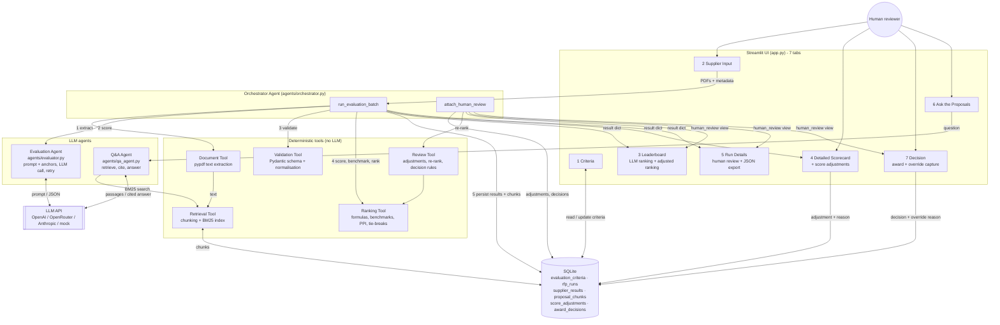
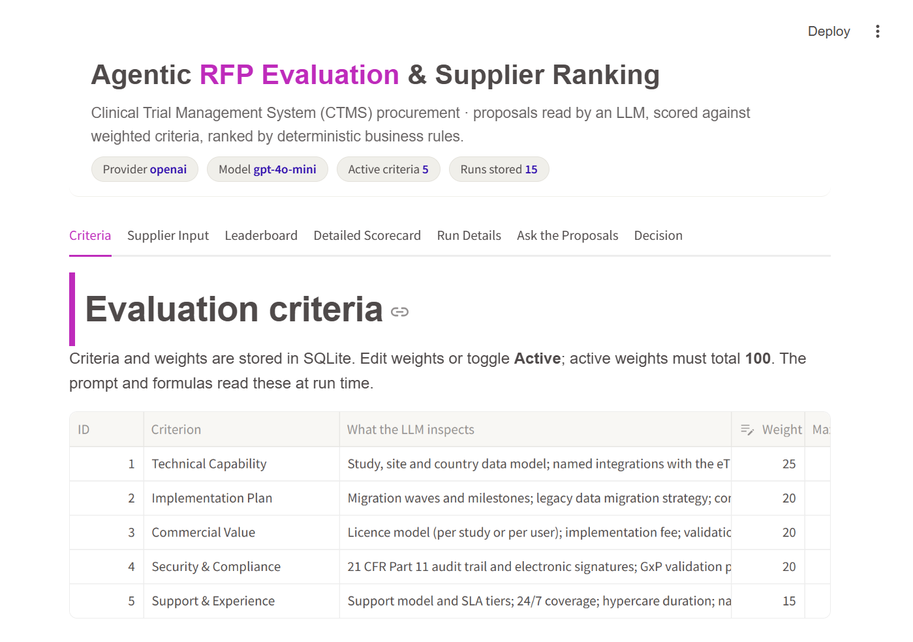
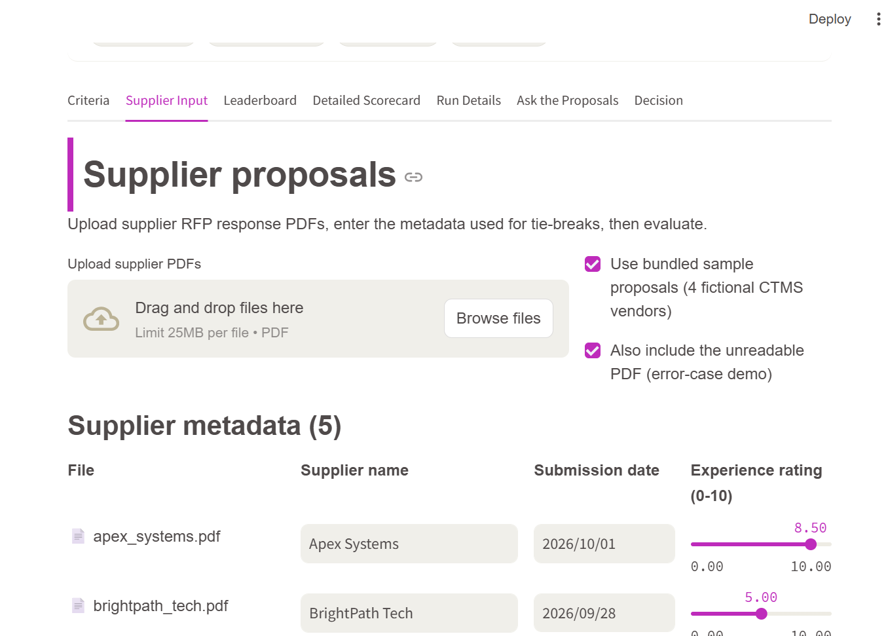
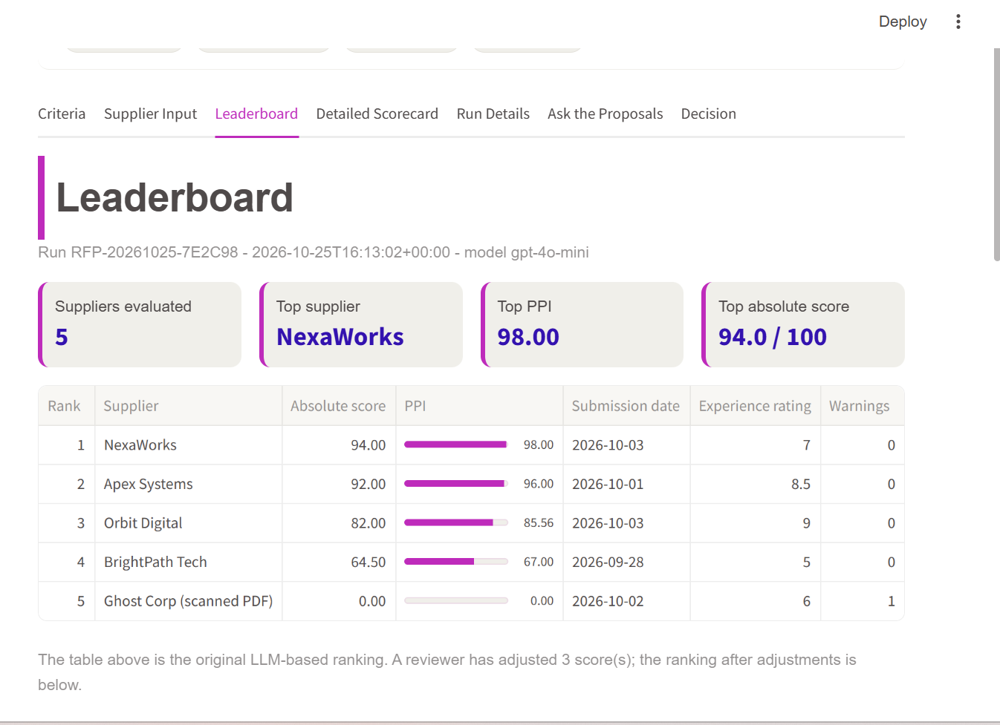
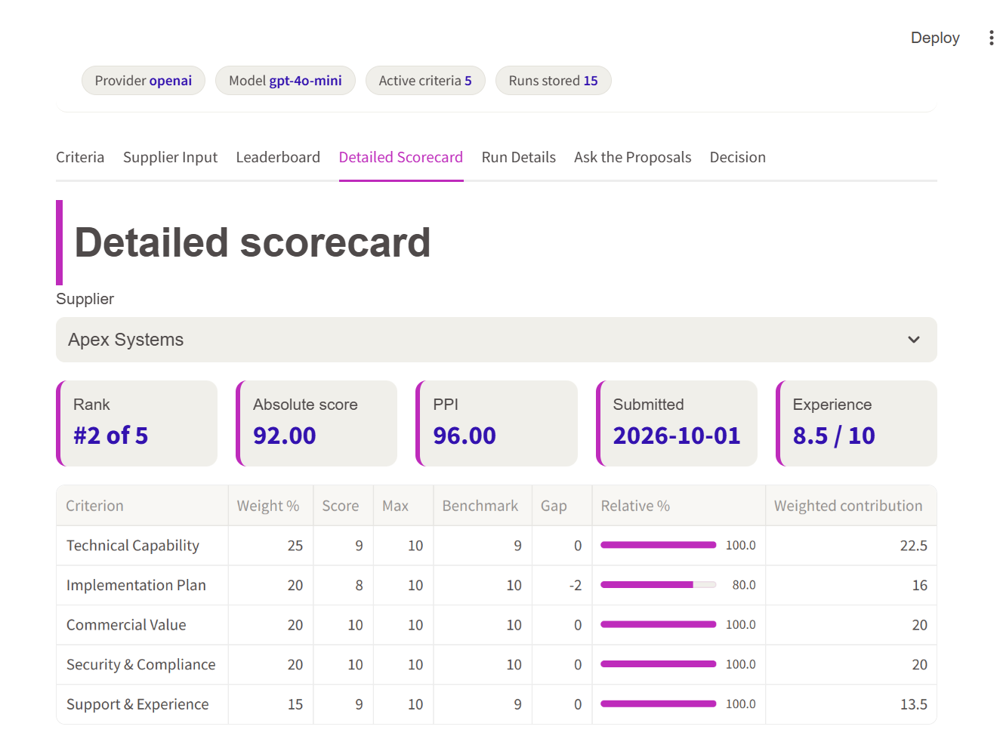
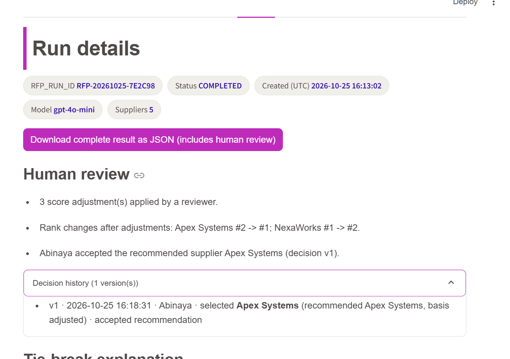
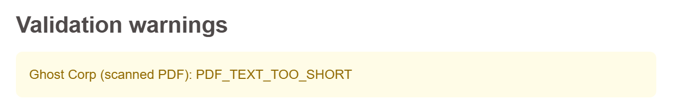
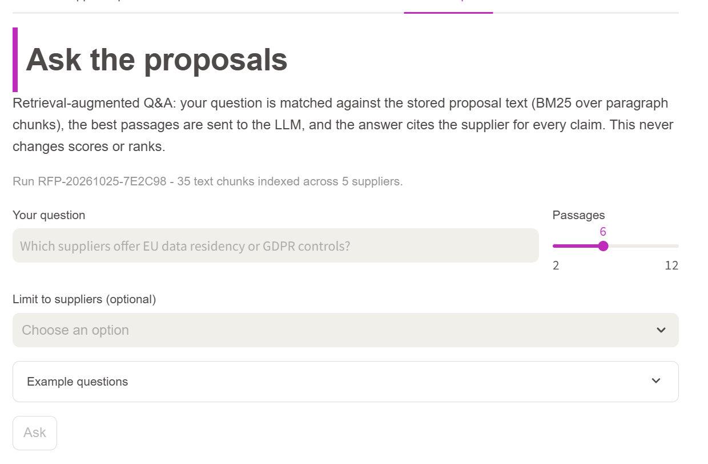
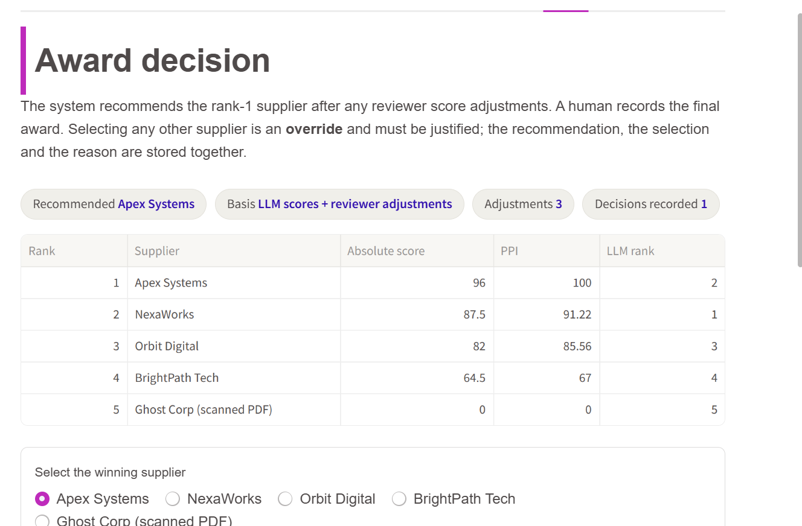

# Agentic RFP Evaluation and Supplier Ranking

An AI-assisted procurement application that reads supplier RFP responses (PDF), asks an LLM to score each proposal against configurable weighted criteria with cited evidence, then applies **deterministic Python** for weighted scoring, peer benchmarking, tie-breaks and ranking. Results are persisted in SQLite and presented in a Streamlit UI with a leaderboard, drill-down scorecards and a JSON export.

**Scenario:** a pharmaceutical sponsor selecting a **Clinical Trial Management System (CTMS)**. Four fictional vendors respond.

**Stack:** Streamlit · SQLite · Python 3.10 · pypdf · Pydantic · OpenAI / Anthropic / OpenRouter (any JSON-capable LLM)

**Live app:** `<paste your Streamlit Community Cloud URL here>`

---

## Table of contents

1. [Business problem](#1-business-problem)
2. [Quick start](#2-quick-start)
3. [Architecture](#3-architecture)
4. [Agentic design: who does what](#4-agentic-design-who-does-what)
5. [Evaluation criteria](#5-evaluation-criteria)
6. [Formulas](#6-formulas)
7. [Tie-break rules](#7-tie-break-rules)
8. [Validation rules](#8-validation-rules)
9. [Database design](#9-database-design)
10. [Streamlit screens](#10-streamlit-screens)
10a. [Ask the Proposals (RAG)](#10a-ask-the-proposals-rag)
10b. [Human-in-the-loop review](#10b-human-in-the-loop-review)
11. [Synthetic supplier proposals](#11-synthetic-supplier-proposals)
11a. [RFP response template](#11a-rfp-response-template)
12. [LLM providers and configuration](#12-llm-providers-and-configuration)
13. [Testing](#13-testing)
14. [Deployment on Streamlit Community Cloud](#14-deployment-on-streamlit-community-cloud)
15. [Demo script](#15-demo-script)
16. [Assumptions and design decisions](#16-assumptions-and-design-decisions)
17. [Project structure](#17-project-structure)
18. [Screenshots](#18-screenshots)

---

## 1. Business problem

A procurement team receives several supplier proposals as PDFs. Reading each one and comparing them consistently is slow and subjective. This system lets the LLM do what it is good at (reading prose, judging how well a proposal addresses a criterion, quoting evidence) while Python does what must be transparent and repeatable (arithmetic, peer comparison, tie-breaks, ranking).

**Golden rule:** the LLM never decides the final arithmetic, benchmark, tie-break or rank. Given the same validated scorecards, the ordering is always identical.

---

## 2. Quick start

```bash
# 1. clone and enter the project
git clone <your-repo-url>
cd IIT-Project

# 2. create a virtual environment (Python 3.10 or newer)
py -3.10 -m venv .venv
.venv\Scripts\activate          # Windows
# source .venv/bin/activate     # macOS / Linux

# 3. install dependencies
pip install -r requirements.txt

# 4. configure the LLM (see section 12)
copy .streamlit\secrets.toml.example .streamlit\secrets.toml
#   then edit .streamlit/secrets.toml and paste your API key

# 5. create and seed the database (the app also does this automatically on first start)
python -m db.seed

# 6. (optional) regenerate the synthetic supplier PDFs
python scripts/generate_rfps.py

# 7. run the app
streamlit run app.py
```

Open http://localhost:8501. On the **Supplier Input** tab tick *Use bundled sample proposals* and click **Evaluate**.

To try the app without any API key, set `LLM_PROVIDER = "mock"` in `secrets.toml`. The mock provider is a deterministic keyword scorer used by the test-suite.

---

## 3. Architecture

### Component view



The LLM touches only two boxes: the Evaluation Agent judges one proposal at a time, and the Q&A Agent answers questions from retrieved passages. Everything that produces a score, a rank or a decision record is deterministic Python or an accountable human action.

### Ten-step data flow

| # | Step | Where | What happens |
|---|---|---|---|
| 1 | Setup | `app.py` | Start Streamlit; seed DB if empty; load active criteria |
| 2 | Input | `app.py` | Upload PDFs; enter supplier name, submission date, experience rating |
| 3 | Batch | `orchestrator.py` | Validate inputs and weights; generate `RFP_RUN_ID`; snapshot criteria into `rfp_runs` |
| 4 | Evaluate | `document_tool.py`, `evaluator.py` | Extract text; build prompt from DB criteria; call LLM (retry once on bad JSON) |
| 5 | Validate | `validation_tool.py` | Parse JSON; fill missing criteria; clip ranges; record warnings |
| 6 | Score | `ranking_tool.py` | Absolute weighted score per supplier |
| 7 | Benchmark | `ranking_tool.py` | Best score per criterion; gap and relative % per supplier |
| 8 | Rank | `ranking_tool.py` | PPI; stable sort by tie-break order; ranks 1..N |
| 9 | Persist | `database.py` | Write `supplier_results` and `proposal_chunks`; mark run `COMPLETED` |
| 10 | Present | `app.py` | Leaderboard, scorecards, run details, JSON download |
| 11 | Ask (optional) | `qa_agent.py`, `retrieval_tool.py` | BM25 retrieval over stored chunks; LLM answers from those passages with supplier citations |
| 12 | Review (optional) | `review_tool.py`, `app.py` | Reviewer adjusts scores with reasons; ranking recomputed and shown beside the LLM ranking |
| 13 | Decide | `review_tool.py`, `database.py` | Reviewer records the award; non-recommended choice is an override with mandatory category and justification; versioned |

---

## 4. Agentic design: who does what

| Component | Responsibility | Implementation | May never |
|---|---|---|---|
| **Orchestrator Agent** | Sequence the tools, isolate per-supplier failures, log steps | Plain Python (`agents/orchestrator.py`) | Contain formulas or prompt text |
| **Document Tool** | Clean text from each PDF; flag unreadable files | `pypdf` | Call the LLM |
| **Evaluation Agent** | Score one supplier against the active criteria and cite evidence | LLM, JSON-only output | Compare suppliers, compute totals or ranks |
| **Validation Tool** | Enforce schema; fill, clip, normalise; record warnings | Pydantic + custom Python | Change a valid score |
| **Ranking Tool** | Formulas, benchmarks, PPI, tie-breaks, ranks | Deterministic Python, no I/O | Call the LLM |
| **Retrieval Tool** | Chunk proposal text; BM25 search for the Q&A feature | Pure Python, no dependencies | Influence scores or ranks |
| **Q&A Agent** | Answer a reviewer's question from retrieved passages, citing suppliers | LLM, plain-text output | Use knowledge outside the passages; change any score |
| **Review Tool** | Validate reviewer adjustments and decisions; re-rank with adjusted scores | Deterministic Python, reuses the Ranking Tool | Overwrite an LLM score; accept an override without a reason |
| **Human reviewer** | Adjust scores with reasons; record the award decision | Streamlit forms, named reviewer | Act anonymously; override without category and justification |

Plain Python functions were chosen over an agent framework: the workflow is a fixed sequence, which keeps the orchestration readable, testable and trivially deployable.

---

## 5. Evaluation criteria

Stored in `evaluation_criteria` and editable from the **Criteria** tab. Active weights must total 100. The prompt and formulas read the criteria at run time, so changing a weight or deactivating a criterion requires no code change.

| ID | Criterion | Weight | Max | What the LLM inspects |
|---|---|---|---|---|
| 1 | Technical Capability | 30 % | 10 | Study/site data model; named eTMF, EDC and SAP integrations; reporting; scalability |
| 2 | Implementation Plan | 20 % | 10 | Migration waves, validation (CSV) phases, training, hypercare, risk register, timeline realism |
| 3 | Commercial Value | 20 % | 10 | Licence model, implementation and validation fees, 5-year TCO, clarity of assumptions |
| 4 | Security & Compliance | 20 % | 10 | 21 CFR Part 11, GxP validation package, GDPR and residency, ISO 27001 / SOC 2, access control |
| 5 | Support & Experience | 10 % | 10 | SLA tiers, 24/7 coverage, hypercare, pharma references, CTMS go-lives |

Each run stores a **snapshot** of the criteria it used (`rfp_runs.criteria_json`), so changing weights later never alters a stored result.

---

## 6. Formulas

| Metric | Formula | Notes |
|---|---|---|
| **Absolute weighted score** | Σ over active criteria of `(score ÷ max_score) × weight` | 0–100 |
| **Criterion benchmark** | `max(score)` for that criterion across all suppliers in the run | validated scores only |
| **Criterion gap** | `score − benchmark` | 0 for the leader, otherwise negative |
| **Relative performance %** | `(score ÷ benchmark) × 100` | if benchmark = 0: 100 when score = 0, else 0 |
| **Peer Performance Index (PPI)** | `Σ (relative % × weight) ÷ Σ weight` | weighted average, 0–100 |

### Worked example

Weights `[30, 20, 20, 20, 10]`, max score 10.

| Criterion | Apex | NexaWorks | Benchmark |
|---|---|---|---|
| Technical | 9 | 7 | 9 |
| Implementation | 7 | 9 | 9 |
| Commercial | 6 | 7 | 7 |
| Security | 9 | 7 | 9 |
| Support | 7 | 9 | 9 |

- Apex absolute = 0.9×30 + 0.7×20 + 0.6×20 + 0.9×20 + 0.7×10 = **78.0**
- NexaWorks absolute = 0.7×30 + 0.9×20 + 0.7×20 + 0.7×20 + 0.9×10 = **76.0**
- Apex relative % = [100, 77.78, 85.71, 100, 77.78] → PPI = **90.48**
- NexaWorks relative % = [77.78, 100, 100, 77.78, 100] → PPI = **88.89**
- Rank: Apex 1, NexaWorks 2 (separated by rule 1, PPI)

These exact numbers are asserted in `tests/test_ranking_tool.py`.

---

## 7. Tie-break rules

Suppliers are sorted once, with a single composite key, in this order:

1. **Higher PPI** first
2. **Earlier submission date** first
3. **Higher historical experience rating** first
4. **Supplier name** ascending (A→Z, case-insensitive)

Ranks 1, 2, 3… are assigned only after this stable sort. For every adjacent pair the app records which rule separated them (shown on the Leaderboard and Run Details tabs), for example:

```
#2 NexaWorks: Rule 1 (PPI): Apex Systems 96.00 vs NexaWorks 93.78
```

---

## 8. Validation rules

`tools/validation_tool.py` never raises and always returns one entry for every active criterion with an integer score inside `[0, max_score]`. Every repair is recorded as a warning code.

| Condition | Action | Warning |
|---|---|---|
| Response not parseable JSON (after one retry) | all criteria score 0 | `LLM_INVALID_JSON` |
| Active criterion missing | insert score 0, "Not returned by model" | `MISSING_CRITERION:<id>` |
| Unknown criterion id | drop | `UNKNOWN_CRITERION:<id>` |
| Duplicate criterion id | keep first | `DUPLICATE_CRITERION:<id>` |
| Score > max | clip to max | `SCORE_CLIPPED_HIGH:<id>` |
| Score < 0 | clip to 0 | `SCORE_CLIPPED_LOW:<id>` |
| Score not numeric | set 0 | `SCORE_NON_NUMERIC:<id>` |
| Score is a float | round half-up | `SCORE_ROUNDED:<id>` |
| Model max_score ≠ DB | use DB value | `MAX_SCORE_OVERRIDDEN:<id>` |
| Empty justification / evidence | "Not provided" | `EMPTY_TEXT_FIELD:<id>` |
| Supplier name ≠ user input | use user input | `SUPPLIER_NAME_MISMATCH` |
| PDF text < 200 characters | skip LLM, all scores 0 | `PDF_TEXT_TOO_SHORT` |
| File is not a readable PDF | skip LLM, all scores 0 | `PDF_EXTRACTION_FAILED` |
| Provider/SDK error | all scores 0 for that supplier | `LLM_CALL_FAILED` |

A failure for one supplier never aborts the batch; the others are still ranked.

---

## 9. Database design

Schema in `db/schema.sql`, seeded by `db/seed.py`.

| Table | Fields |
|---|---|
| `evaluation_criteria` | `criterion_id`, `name`, `description`, `weight`, `max_score`, `is_active`, `created_at`, `updated_at` |
| `rfp_runs` | `rfp_run_id`, `created_at`, `status` (RUNNING / COMPLETED / FAILED), `criteria_json` (snapshot), `warnings_json`, `llm_model`, `error_message` |
| `supplier_results` | `result_id`, `rfp_run_id` (FK, cascade), `supplier_name`, `submission_date`, `experience_rating`, `absolute_score`, `ppi`, `final_rank`, `result_json` (full per-criterion detail) |
| `proposal_chunks` | `chunk_pk`, `rfp_run_id` (FK, cascade), `supplier_name`, `chunk_id`, `text`, `char_start` — text chunks for the Ask the Proposals feature |
| `score_adjustments` | `adjustment_id`, `rfp_run_id` (FK, cascade), `supplier_name`, `criterion_id`, `original_score`, `adjusted_score`, `reason`, `reviewer`, `created_at` — one current adjustment per run/supplier/criterion |
| `award_decisions` | `decision_id`, `rfp_run_id` (FK, cascade), `version`, `basis` (llm / adjusted), `recommended_supplier`, `selected_supplier`, `is_override`, `reason_category`, `reason_text`, `reviewer`, `decided_at`, `adjustments_json` — versioned human award decisions |

```bash
python -m db.seed            # create + seed if empty
python -m db.seed --reset    # drop and reseed
```

---

## 10. Streamlit screens

| Tab | Shows |
|---|---|
| **1. Criteria** | Editable table (weight, active flag), live active-weight total, Save / Restore defaults |
| **2. Supplier Input** | Multi-PDF upload or bundled samples, per-supplier name / date / rating, validation messages, Evaluate button with progress and step log |
| **3. Leaderboard** | Rank, supplier, absolute score, PPI, date, rating; PPI bar chart; tie-break explanation |
| **4. Detailed Scorecard** | Per-criterion score, benchmark, gap, relative %, weight, weighted contribution; evidence and justification; risks; summary; warnings |
| **5. Run Details** | `RFP_RUN_ID`, status, model, JSON download, tie-break list, warnings, criteria snapshot, benchmarks, workflow log |
| **6. Ask the Proposals** | Retrieval-augmented Q&A across the run's proposals with supplier citations and the retrieved passages |
| **7. Decision** | Human award decision: recommended supplier, winner selection, mandatory reason capture for overrides, versioned decision history |

The sidebar shows the LLM configuration and lets you reload any previous run.

**Theme.** The UI uses the Bristol Myers Squibb core palette: BMS Purple `#BE2BBB` as the accent and primary action colour, white `#FFFFFF` and Light Gray `#F0EFEA` surfaces, Dark Gray `#4F4A4A` text, Dark Indigo `#3312AF` for emphasis and Light Indigo `#496FE3` for the data chart, with an Arial/Helvetica font stack. Theme values live in `.streamlit/config.toml`; the small CSS layer is at the top of `app.py`. The BMS logo is deliberately not included, since it is reserved for authorised corporate materials.

---

## 10a. Ask the Proposals (RAG)

A retrieval-augmented generation feature that sits beside the scoring pipeline and never changes scores, benchmarks or ranks.

```
question -> BM25 retrieval over stored chunks -> LLM answers from those passages only -> answer + cited passages
```

| Piece | Where | Notes |
|---|---|---|
| Chunking | `tools/retrieval_tool.py::chunk_text` | Paragraph-aligned chunks of ~700 characters (hard cap 1,000, long paragraphs split on sentences); a short trailing paragraph is repeated in the next chunk as overlap |
| Index | `tools/retrieval_tool.py::BM25Index` | Pure-Python Okapi BM25 (k1 = 1.5, b = 0.75), lower-cased tokens with a small stopword list; deterministic tie-break by chunk order; optional supplier filter |
| Storage | `proposal_chunks` table | Written by the orchestrator in step 9, deleted with the run (cascade) |
| Agent | `agents/qa_agent.py::answer_question` | Retrieves top-k (default 6, max 12) passages and prompts the model to answer **only** from them, citing suppliers in square brackets and naming suppliers that are silent |
| UI | `app.py` tab 6 | Question box, passage count, optional supplier filter, example questions, answer, and an expander with every retrieved passage and its BM25 score |

Why BM25 rather than embeddings: the proposals share the RFP's vocabulary, BM25 is deterministic and offline-testable, and it adds no dependency or API cost. An embedding index (for example OpenAI `text-embedding-3-small` with cosine similarity) could be dropped in behind the same `search(query, k)` interface.

Example (real run, gpt-4o-mini): *"Which suppliers offer EU data residency or GDPR controls?"* returned a supplier-by-supplier answer citing Apex Systems (Frankfurt + Dublin replica), NexaWorks (EU or US hosting) and Orbit Digital (US hosting, EU "can be discussed"), and stated that BrightPath Tech was silent on the topic.

Failure handling: no matching passages returns a clear message without calling the model; a model error still shows the retrieved passages so the user can read them directly.

---

## 10b. Human-in-the-loop review

The automated pipeline ends with a recommendation, not an award. A named reviewer closes the loop in two governed steps. Neither step changes the LLM output or the stored LLM ranking; both are recorded beside it.

```
LLM scores -> validate -> deterministic rank  ==>  [1] reviewer adjusts scores (reason required)
                                                    [2] reviewer records the award decision
                                                        accept rank 1, or override with category + justification
                                              ==>  persist + export (LLM view and human view side by side)
```

### Step 1: score adjustments (Detailed Scorecard tab)

| Rule | Implementation |
|---|---|
| Reviewer name required | Sidebar field; forms are disabled until it is filled |
| Reason of at least 10 characters required | `tools/review_tool.py::validate_adjustment` |
| Score must be an integer within 0..max and differ from the LLM score | same |
| LLM score is never overwritten | adjustment stored in `score_adjustments` with `original_score`; `result_json` untouched |
| Ranking is recomputed with the same formulas | `apply_adjustments` rebuilds Ranking Tool entries and calls `score_and_rank` |
| Both rankings are visible | Leaderboard shows the LLM ranking and, when adjustments exist, a "Human-adjusted ranking" table with LLM rank, change, and both score sets |

### Step 2: award decision (Decision tab)

| Rule | Implementation |
|---|---|
| Recommendation = rank 1 of the ranking the reviewer saw (adjusted if any adjustments exist) | `recommended_supplier` on the adjusted result; `basis` stored as `llm` or `adjusted` |
| Accepting the recommendation needs no reason (notes optional) | `validate_decision` |
| Selecting any other supplier is an **override**: a reason category and a justification of at least 10 characters are mandatory | `validate_decision`; UI shows the error until satisfied |
| Every save is a new version; history is never rewritten | `award_decisions.version`, `get_decision_history` |
| The decision snapshots the adjustments in force at the time | `adjustments_json` column |

Override categories: strategic relationship / incumbent advantage; risk appetite; budget constraint; reference check outcome; timeline pressure; scope or requirement clarification after scoring; other.

### Where the review appears

- **Run Details**: a "Human review" block with plain-language summary lines (adjustments, rank changes, acceptance or an OVERRIDE warning) and the decision history.
- **JSON export**: a `human_review` object containing `adjustments`, `adjusted_ranking` (each criterion with `original_score`, `adjusted`, `adjustment_reason`, `adjusted_by`), `recommended_supplier`, `decision`, `decision_history` and `summary`. The original `suppliers` array is the unmodified LLM ranking.

The LLM is never asked to evaluate or justify the human choice, so the three roles stay separate: the model judges content, Python computes, the human decides and is accountable for deviations.

---

## 11. Synthetic supplier proposals

Generated by `scripts/generate_rfps.py` (reportlab) into `data/sample_rfps/`. All companies, people, references and figures are fictional.

| File | Supplier | Deliberate profile |
|---|---|---|
| `apex_systems.pdf` | Apex Systems | Named REST / CDISC ODM / SAP BAPI integrations, full IQ/OQ/PQ pack, Part 11 and GDPR residency, 14 months, highest price ($4.8M TCO) |
| `brightpath_tech.pdf` | BrightPath Tech | Lowest price ($1.9M), 7-month big bang, validation left to the client, no Part 11 / GDPR text, business-hours support, two small references |
| `nexaworks.pdf` | NexaWorks | Mid price ($3.2M), four-wave plan with exit gates, dedicated validation lead, tiered 24x7 SLAs, 8-week hypercare |
| `orbit_digital.pdf` | Orbit Digital | Medium price ($3.0M), "standard connectors" with nothing named, brief validation, 15 references and 10 years in market |
| `broken_empty.pdf` | (error case) | Valid PDF with no text layer; triggers `PDF_TEXT_TOO_SHORT` |

Each proposal has the six required sections: executive summary, solution and approach, timeline and team, price table with assumptions, security and compliance, support and references.

---

## 11a. RFP response template

The evaluator accepts any text-based PDF, but it scores most reliably when a proposal follows the structure below. Each section maps to the criteria the LLM is asked to inspect, so a missing section usually means a low score with "no evidence found" in the justification.

A fill-in version with tables and a submission checklist is in [`docs/rfp_response_template.md`](docs/rfp_response_template.md). The four bundled proposals were written from it.

| # | Section | What it must contain | Scored under |
|---|---|---|---|
| — | Header | Supplier name (exactly as entered in the app), RFP reference, submission date, contact | Tie-breaks (date) |
| 1 | Executive summary and understanding of the requirement | Restated buyer goals, proposition in 2–3 sentences, key risks and where they are addressed | Context for all criteria |
| 2 | Proposed solution and implementation approach | Architecture, **named** integrations per buyer system with protocol and frequency, reporting, scalability | Technical Capability |
| 3 | Timeline, team structure and milestones | Waves or phases with months and exit criteria, data migration strategy, IQ/OQ/PQ ownership, team FTEs, risk register, training and hypercare | Implementation Plan |
| 4 | Pricing and assumptions | Price table by year and 5-year total, pricing model, every assumption, exclusions | Commercial Value |
| 5 | Security, compliance and risk controls | 21 CFR Part 11 / Annex 11, validation package, ISO 27001 / SOC 2 with identifiers, GDPR and data residency, access control, encryption, backups | Security & Compliance |
| 6 | Support model, relevant experience and references | SLA table by severity, support hours, availability commitment, hypercare, comparable deployments, at least three references | Support & Experience |

Practical rules that affect scoring:

- **Specific beats generic.** "REST API to the eTMF, 15-minute sync" scores higher than "integrates with major systems". The prompt tells the model that vague or unsupported claims score lower.
- **Silence is scored.** If a section is absent the model is instructed to give a low score and say no evidence was found, which is exactly how BrightPath Tech loses marks on compliance.
- **Text-based PDF only.** Scanned images have no text layer and are rejected with `PDF_TEXT_TOO_SHORT`. Export from Word or Google Docs rather than printing to image.
- **Length.** Two to six pages is ideal. Text beyond roughly 12,000 characters is truncated with a warning.
- **Supplier name consistency.** The name typed in the app is authoritative; a different name inside the PDF is overridden and logged as `SUPPLIER_NAME_MISMATCH`.

Buyer-side RFP context used in the prompt (the request these proposals answer): a mid-size pharma sponsor with about 40 active studies in 12 countries replacing a legacy on-premise CTMS with a validated cloud CTMS integrated with eTMF, EDC and SAP, automating site payments, migrating within 12 months, and meeting 21 CFR Part 11, GxP, GDPR and ISO 27001 requirements. To reuse the evaluator for a different procurement, change `RFP_CONTEXT` in `agents/evaluator.py` and the criteria descriptions in `db/seed.py`.

---

## 12. LLM providers and configuration

Secrets are read from `.streamlit/secrets.toml` locally, or from the app's **Secrets** settings on Streamlit Community Cloud.

```toml
LLM_PROVIDER = "openai"          # openai | openrouter | anthropic | mock
LLM_API_KEY  = "sk-..."
LLM_MODEL    = "gpt-4o-mini"     # defaults: openai gpt-4o-mini, openrouter openai/gpt-4o-mini, anthropic claude-opus-5-5
# LLM_BASE_URL = ""              # optional, for other OpenAI-compatible endpoints
```

| Provider | Notes |
|---|---|
| `openai` | JSON mode (`response_format: json_object`). Used for the sample run. |
| `openrouter` | Same client with `base_url = https://openrouter.ai/api/v1`; any OpenRouter model id. |
| `anthropic` | Official SDK; JSON enforced by prompt + validation. |
| `mock` | No network. Deterministic keyword scorer for tests and offline demos. |

The prompt (`agents/evaluator.py`) instructs the model to use only evidence in the document, return one result per active criterion, stay within range, and output JSON only. It also carries **scoring anchors**: a 0–10 band table (10 = every inspected item specific and verifiable … 0–1 = not addressed) and an instruction to judge each inspected item as specific / generic / absent before picking a band. On malformed JSON the agent retries once with a correction message.

### Score stability (LLM variance)

The ranking tool is fully deterministic: identical validated scorecards always give identical results, which is the brief's success condition. The LLM step is not deterministic by nature, and the two strongest synthetic suppliers were written to be close rivals, so a one-point swing on the 30 %-weight criterion can swap first and second place. Two measures reduce that drift:

| Setting | Where | Effect |
|---|---|---|
| `temperature = 0` and a fixed `seed` on OpenAI-compatible calls | `OpenAIClient.complete` | Greedy decoding plus OpenAI's best-effort seed; if a model rejects these parameters the call is retried without them |
| Scoring anchors in the system prompt | `build_system_prompt` | Less subjective rounding on borderline criteria |

Measured on the four bundled proposals with `gpt-4o-mini`:

| Condition | Runs | Avg. total score difference between two runs (20 criterion scores) | Winner |
|---|---|---|---|
| Default sampling, no anchors | 6 | 8.9 points | Apex 3 times, NexaWorks 3 times |
| Temperature 0 + seed + anchors | 2 | 2 points (only two Orbit scores moved by 1) | NexaWorks both times, identical full ranking |

The Anthropic provider does not accept sampling parameters on current models, so it relies on the anchors alone. Residual drift is a property of the model, not of the pipeline, and is visible in the sidebar run history.

---

## 13. Testing

```bash
python -m pytest
```

136 tests across nine files:

| File | Covers |
|---|---|
| `test_document_tool.py` | Sample PDFs readable, broken PDF flagged, non-PDF bytes raise, whitespace cleanup, truncation |
| `test_validation_tool.py` | Every rule in section 8, inactive criteria handling |
| `test_ranking_tool.py` | Worked example, zero benchmark, weighted PPI, all four tie-break rules, determinism, output shape |
| `test_evaluator.py` | Prompt built from DB criteria, JSON parsing, retry logic, provider factory |
| `test_orchestrator.py` | Full pipeline on the sample PDFs (mock LLM), persistence, criteria snapshot, failure isolation, FAILED status |
| `test_retrieval_tool.py` | Tokenisation, chunk coverage and overlap, long-paragraph splitting, BM25 ranking, filters, determinism, sample-PDF retrieval |
| `test_qa_agent.py` | Prompt shape, retrieval, supplier filter, empty/no-match/model-failure paths, chunk persistence by the orchestrator, cascade delete |
| `test_review_tool.py` | Adjustment validation (reviewer, reason length, range, unknown supplier/criterion, no-op), re-ranking with traceability fields, input not mutated, decision rules (override needs category + justification), persistence of adjustments and versioned decisions, `attach_human_review` export shape, cascade delete |
| `conftest.py` | Shared criteria fixture |

The UI was additionally exercised with Streamlit's `AppTest` harness (all six tabs, Evaluate button, invalid-weights guard, a real question on the Ask tab and its no-match path).

---

## 14. Deployment on Streamlit Community Cloud

1. Push the repository to GitHub (public). `data/*.db` and `.streamlit/secrets.toml` are git-ignored.
2. Go to https://share.streamlit.io → **New app** → select the repo, branch `main`, main file `app.py`.
3. **Advanced settings → Python version:** 3.10 or 3.11.
4. **Advanced settings → Secrets:** paste the three lines from section 12 with your real key.
5. Deploy. On first start the app creates and seeds the SQLite database automatically.
6. Open the public URL, tick *Use bundled sample proposals*, click **Evaluate**, and confirm the leaderboard appears.

Community Cloud storage is ephemeral: the database resets on redeploy or restart. Criteria are reseeded automatically; past runs are lost. This is acceptable for the classroom scope and noted under assumptions.

---

## 15. Demo script

1. **Criteria tab** – show the five criteria and the weight total. Untick *Support & Experience*, click Save, show the red total and the disabled Evaluate button. Click *Restore defaults*.
2. **Supplier Input tab** – tick *Use bundled sample proposals*; point out name, date and rating per supplier. Click **Evaluate**; watch the step log.
3. **Leaderboard tab** – read the ranking; open *How the ranking was decided*.
4. **Detailed Scorecard tab** – pick BrightPath Tech; open the Security & Compliance expander to show the low score and the justification citing missing Part 11 / GDPR detail.
5. **Run Details tab** – show `RFP_RUN_ID`, the criteria snapshot, benchmarks, and click **Download complete result as JSON**.
6. **Error case** – back on Supplier Input, tick *Also include the unreadable PDF*, Evaluate again; show the `PDF_TEXT_TOO_SHORT` warning and Ghost Corp at the bottom with zero scores while the others still rank.
7. **Ask the Proposals tab** – ask *"Which suppliers offer EU data residency or GDPR controls?"*; show the cited answer and open the retrieved passages. Then ask something not in the documents to show the no-match message.
8. **Human review** – type your name in the sidebar. On the Detailed Scorecard, raise one score for the rank-2 supplier with a reason; show the Leaderboard now listing both the LLM ranking and the human-adjusted ranking. On the Decision tab, select a supplier other than the recommended one, pick a reason category, write the justification, save; show the OVERRIDE record on Run Details and in the JSON download.
9. **Sidebar** – reload the previous run from *Run history*.

---

## 16. Assumptions and design decisions

- **Plain Python orchestration, no agent framework.** The workflow is a fixed sequence; functions are easier to test, deploy and explain.
- **Scores are integers 0–10.** Floats from the model are rounded half-up with a warning.
- **Weights and max scores always come from the database snapshot**, never from the model's JSON, so a model cannot distort the arithmetic.
- **Benchmarks use validated scores**, including filled or clipped ones.
- **Relative % when the benchmark is 0** is 100 if the supplier also scored 0 (all equal), otherwise 0.
- **Criteria snapshot per run.** Later weight changes never alter stored results.
- **Text truncation** at ~12,000 characters keeps the start of the document and records a warning; the synthetic proposals are far below this. For real 50–200 page proposals, per-criterion retrieval using the existing `tools/retrieval_tool.py` chunks would replace truncation.
- **Per-supplier failure isolation.** Unreadable PDFs, provider errors and malformed JSON zero that supplier and warn; the batch still completes.
- **LLM variance is managed, not eliminated.** OpenAI-compatible calls use temperature 0 and a fixed seed, and the prompt carries scoring anchors; the Anthropic provider accepts no sampling parameters on current models. Determinism is guaranteed downstream of validation, and residual drift between runs is a documented property of the model (see section 12).
- **Ephemeral database on Community Cloud.** Criteria reseed automatically on start.
- **Human review is additive and accountable.** Reviewer adjustments and award decisions are stored beside the LLM results, never in place of them; every change carries a name and a reason, overrides require a category and justification, and decisions are versioned. The LLM is never asked to judge the human choice.
- **All supplier data is fictional.** No real vendor, pricing, reference or internal document is used.

---

## 17. Project structure

```
IIT-Project/
├── app.py                        Streamlit UI (five tabs + sidebar)
├── requirements.txt
├── README.md
├── BUILD_PLAN.md                 Detailed build reference
├── run_app.cmd                   Windows launcher
├── .streamlit/
│   ├── config.toml
│   └── secrets.toml.example
├── agents/
│   ├── orchestrator.py           run_evaluation_batch, load_run_result
│   ├── evaluator.py              build_prompt, evaluate_supplier, provider clients
│   └── qa_agent.py               answer_question (retrieval-augmented Q&A)
├── tools/
│   ├── document_tool.py          extract_text, truncate_for_prompt
│   ├── validation_tool.py        validate_and_normalise, empty_evaluation
│   ├── ranking_tool.py           score_and_rank, rank_suppliers, explain_tie_breaks
│   ├── retrieval_tool.py         chunk_text, BM25Index
│   └── review_tool.py            apply_adjustments, validate_adjustment, validate_decision
├── db/
│   ├── schema.sql
│   ├── seed.py                   CTMS criteria seed
│   └── database.py               SQLite helpers
├── data/
│   ├── sample_rfps/              4 fictional proposals + broken_empty.pdf
│   └── sample_output.json        Export of one completed run (OpenAI gpt-4o-mini)
├── scripts/
│   └── generate_rfps.py          Builds the synthetic PDFs
├── tests/                        136 pytest tests
└── docs/screenshots/             UI screenshots for this README
```

---

## 18. Screenshots

Add screenshots to `docs/screenshots/` with these names and they will render below.

| Screen | File |
|---|---|
| Criteria |  |
| Supplier Input |  |
| Leaderboard |  |
| Detailed Scorecard |  |
| Run Details |  |
| Error case |  |
| Ask the Proposals |  |
| Decision (override) |  |
